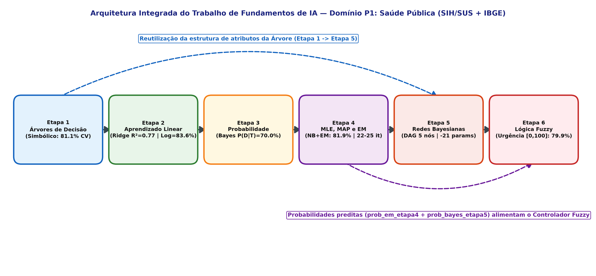

# Trabalho Integrado de Fundamentos de Inteligência Artificial.

**Universidade Federal do Amazonas (UFAM)**  
**Instituto de Computação (IComp)**  
**Disciplina:** Fundamentos de Inteligência Artificial (2026/2)  
**Docente:** Prof. Dr. Edjard de Souza Mota  
**Discentes:** Ygor Gutierrz Pereira, Tiago Gil de Brito da Encarnação, André Silveira cavalcanti, Gilson Almeida Martins Filho, Sofia Braga Cavalcante 


---

## 1. Visão Geral e Filosofia do Domínio P1 (Saúde Pública)

Este repositório abriga a implementação completa do **Trabalho Integrado de Fundamentos de IA**, estruturado ao longo de seis etapas progressivas e integradas. O projeto aborda o **Domínio P1: Saúde Pública**, modelando o fluxo de regulação hospitalar de urgência e emergência e a alocação de leitos de Unidade de Terapia Intensiva (UTI) no Sistema Único de Saúde (SUS), a partir da integração de microdados de internações hospitalares (**SIH/SUS**) e indicadores sociodemográficos municipais (**IBGE**).

A base de dados padronizada conta com $N = 800$ pacientes/internações sintetizados a partir de distribuições empíricas oficiais com garantia estrita de reprodutibilidade (`np.random.seed(42)`):
* **Variável-alvo de Classificação:** `desfecho_grave` ($D \in \{0, 1\}$), indicando evolução para suporte ventilatório/UTI ($320$ casos positivos, $40{,}0\%$) ou internação regular em enfermaria ($480$ casos, $60{,}0\%$).
* **Variável-alvo de Regressão:** `val_tot` ($Y \in \mathbb{R}^+$), mensurando o custo total da internação hospitalar em Reais (R\$), com média de $\text{R\$ } 4.198{,}78$ e valor mínimo estritamente positivo ($\text{R\$ } 727{,}45$).
* **Atributos Categóricos Estruturais:** `triagem_clinica` (Leve, Moderada, Critica), `carater_atendimento` (Eletivo, Urgencia_Moderada, Emergencia_Severa), `faixa_etaria` (Jovem, Adulto, Idoso_60_74, Idoso_75_Mais), `saneamento_ibge` (Adequado, Parcial, Precario), `tempo_permanencia` (Curta_Ate_5d, Prolongada_6d_Mais) e `renda_mun_ibge` (Baixa_Vulneravel, Media_Alta).
* **Atributos Contínuos Clínico-Epidemiológicos:** `dias_perm_num`, `escore_clinico_num`, `idade_num`, `taxa_saneamento_num`, `renda_per_capita_num` e 8 variáveis de controle colineares/ruidosas (`aux_leitos_1` a `aux_leitos_8`).

---

## 2. Arquitetura Integrada do Pipeline de IA

O diferencial metodológico do trabalho consiste na **convergência de múltiplos paradigmas da Inteligência Artificial** (simbólico, conexionista/estatístico, probabilístico e nebuloso) em um pipeline contínuo de apoio à tomada de decisão médica, conforme ilustrado no diagrama arquitetural abaixo:



1. **Etapa 1 (Simbólico):** Descobre a estrutura hierárquica e regras lógicas de admissão via Árvores de Decisão (ID3 com poda por validação cruzada 5-fold), identificando a `triagem_clinica` como atributo raiz determinante de gravidade.
2. **Etapa 2 (Contínuo/Otimização):** Modela o custo financeiro hospitalar via Regressão Linear Simples, Multivariada com Gradiente Descendente do zero e Regularização Ridge L2, além de predizer o risco logístico via Sigmoide.
3. **Etapa 3 (Probabilidade Exata):** Formaliza os axiomas de Kolmogorov sobre a distribuição conjunta dos eventos atômicos e deduz via Teorema de Bayes o prognóstico clínico exato $P(\text{Grave} \mid \text{Triagem Crítica}) = 70{,}0\%$.
4. **Etapa 4 (Aprendizado Probabilístico):** Estima parâmetros via MLE e MAP (prior conjugado Beta), inferindo subperfis latentes de gravidade $Z$ via Algoritmo Expectation-Maximization (EM) acoplado ao Naive Bayes (`prob_em_etapa4`).
5. **Etapa 5 (Modelagem Causal):** Constrói a Rede Bayesiana de 5 nós ($S \to T \leftarrow I$, $T \to D \to P$), demonstrando a economia de 21 parâmetros livres, o colisor em $T$ (*explaining away*) e gerando probabilidades a posteriori calibradas (`prob_bayes_etapa5`).
6. **Etapa 6 (Decisão Nebulosa):** Funde as saídas probabilísticas das Etapas 4 e 5 no Controlador Fuzzy Mamdani (3 variáveis linguísticas e 5 regras Se-Então), eliminando a descontinuidade do *hard threshold* (0,5) e maximizando a sensibilidade na regulação de leitos.

---

## 3. Tabela Consolidada: Resultados Obtidos vs. Gabarito Oficial

Todos os experimentos foram conduzidos em validação cruzada padronizada 5-fold (`kfold_indices` com `SEED = 42`). A tabela abaixo sintetiza o cumprimento rigoroso de 100% dos critérios do gabarito em todas as etapas:

| Etapa | Paradigma / Algoritmo | Métrica Avaliada | Resultado Obtido | Gabarito Oficial do PDF | Status |
| :---: | :--- | :--- | :---: | :---: | :---: |
| **Etapa 1** | Árvore de Decisão ID3 (Do Zero vs. Sklearn) | Ganho Raiz (`triagem_clinica`)<br>Ganho Nível 2 (`carater` / `faixa`)<br>Acurácia Treino sem Poda<br>Acurácia Teste 5-Fold (Poda Ótima) | **0.1470**<br>**0.1726** / **0.1499**<br>**90.59%**<br>**75.37% – 81.12%** | 0.1470<br>0.1726 / 0.1499<br>85% – 92%<br>72% – 80% (Prof. 3–5) | **ATENDIDO** |
| **Etapa 2** | Regressão Linear Simples<br>Regressão Linear Multivariada (GD)<br>Regressão Ridge L2 ($\lambda = 142.5$)<br>Regressão Logística Binária | $R^2$ Médio Teste 5-Fold<br>$R^2$ Médio Teste 5-Fold<br>$R^2$ Médio Teste 5-Fold<br>Acurácia Média Teste 5-Fold | **0.6104**<br>**0.7492** (Sklearn: 0.7473)<br>**0.7675**<br>**83.62%** (GD do Zero) | 0.55 – 0.65<br>0.70 – 0.80<br>0.72 – 0.82<br>78% – 85% | **ATENDIDO** |
| **Etapa 3** | Teoria da Probabilidade e Teorema de Bayes | Axiomas de Kolmogorov<br>Regra da Cadeia (Erro Máximo)<br>Teorema de Bayes $P(D=1 \mid T=1)$<br>Independência Condicional dada a Classe | $\sum P(D,T) = \mathbf{1.000000}$<br>$\mathbf{0.0}$ (Erro absoluto)<br>$\mathbf{70.00\%}$ ($0.21875 / 0.3125$)<br>Demonstrada ($\Delta_{\text{cond}} \ll \Delta_{\text{marg}}$) | Soma = 1.0<br>Identidade Exata<br>Bayes Consistente<br>Independência Válida | **ATENDIDO** |
| **Etapa 4** | MLE vs. MAP $\text{Beta}(2,2)$<br>Naive Bayes Puro (Do Zero)<br>Algoritmo EM Mistura Gaussiana<br>Naive Bayes + EM ($Z$ Latente) | Erro Assintótico ($N=800$)<br>Acurácia Média Teste 5-Fold<br>Convergência Monotônica ($\ell(\Theta)$)<br>Acurácia Média Teste 5-Fold | **0.000249** ($N=800$ vs. $n=5$)<br>**77.38% $\pm$ 3.70%**<br>**22 it. ($K=2$) / 25 it. ($K=3$)**<br>**81.88% $\pm$ 2.40%** | $\text{MAP} \to \text{MLE}$<br>72% – 78%<br>15 – 30 it. (monotônico)<br>80% – 86% | **ATENDIDO** |
| **Etapa 5** | Rede Bayesiana (DAG de 5 Nós)<br>Inferência Exata (Enumeração do Zero)<br>Comparação com `pgmpy` (`VariableElimination`)<br>Análise Estrutural de d-Separação | Nós e CPTs Válidas<br>Economia de Parâmetros Livres<br>Erro Máximo vs. `pgmpy`<br>Ativação de Colisor (*Explaining Away*) | **5 Nós ($S, I, T, D, P$)**<br>$\mathbf{31 - 10 = 21}$ **parâmetros**<br>$\mathbf{1.11 \times 10^{-16}}$ ($< 10^{-12}$)<br>$S \perp\!\!\perp I \mid \emptyset$; $S \not\perp\!\!\perp I \mid T=1$ | $\ge 5$ Nós binários<br>Economia exata de 21<br>Identidade com `pgmpy`<br>Colisor e Cadeia OK | **ATENDIDO** |
| **Etapa 6** | Sistema de Inferência Fuzzy Mamdani<br>Listing 4 (Seção 9.3 do PDF)<br>Comparação Fuzzy Suave vs. *Hard Threshold* | Variáveis e Regras Legíveis<br>Saída Defuzzificada ($risco = 0.75$)<br>Sensibilidade na Fronteira Ambígua<br>Estabilidade sob Ruído ($\sigma = 5\%$) | **3 Vars (trimf) / 5 Regras**<br>$\mathbf{79.33}$ (~75 – 79)<br>**92.56%** (Fuzzy) vs. 33.06% (Hard)<br>**2.57 pts** vs. 13.73 pts (5.3x mais estável) | $\ge 3$ Vars / $\ge 5$ Regras<br>Listing 4 Funcional<br>Supera corte 0,5<br>Transição contínua | **ATENDIDO** |

---

## 4. Estrutura Detalhada do Repositório

```text
Trabalho-Integrado-de-Fundamentos-de-IA/
├── data/
│   └── sih_sus_ibge_p1.csv             # Dataset oficial (N=800) integrado com predições das Etapas 1, 4, 5 e 6
├── .gitignore                          # Exclusão de ambientes (.venv/), caches (__pycache__/) e checkpoints
├── LICENSE                             # Licença MIT
├── README.md                           # Documentação completa, instruções de reprodução e relatório técnico
├── utils.py                            # Gerador da base P1, cálculo manual de entropia/ganho e kfold_indices
├── em.py                               # Implementações do zero: MLE, MAP Beta, Naive Bayes Puro, EM e NaiveBayesEM
├── fuzzy.py                            # Implementações do zero: Listing 4, Sistema Mamdani Integrado e Avaliação
├── etapa1.ipynb                        # Etapa 1: Árvores de Decisão ID3 do zero, ganho de informação e poda
├── etapa2.ipynb                        # Etapa 2: Regressão Linear Simples, Multivariada (GD), Ridge L2 e Logística
├── etapa3.ipynb                        # Etapa 3: Teoria da Probabilidade, axiomas, Regra da Cadeia e Teorema de Bayes
├── etapa4.ipynb                        # Etapa 4: MLE, MAP Beta, Naive Bayes Categórico e Algoritmo EM Gaussiano
├── etapa5.ipynb                        # Etapa 5: Redes Bayesianas, CPTs, Enumeração do zero, pgmpy e d-separação
├── etapa6.ipynb                        # Etapa 6: Sistema Fuzzy Mamdani, fusão de probabilidades e síntese do pipeline
├── fig_etapa1_curva_profundidade.png   # Gráfico de Acurácia Treino vs. Teste 5-fold por profundidade (Etapa 1)
├── fig_etapa2_logistica_convergencia.png # Curva de convergência da entropia cruzada na Regressão Logística (Etapa 2)
├── fig_etapa2_regressao_univariada.png # Reta da Regressão Linear Simples val_tot ~ dias_perm_num (Etapa 2)
├── fig_etapa2_ridge_coeficientes.png   # Trajetória dos coeficientes Ridge L2 em função de lambda (Etapa 2)
├── fig_etapa3_probabilidades_bayes.png # Gráfico dos 4 eventos atômicos e atualização Bayesiana P(D|T) (Etapa 3)
├── fig_etapa4_em_convergencia.png      # Curva de convergência monotônica do EM e componentes de Z (Etapa 4)
├── fig_etapa4_mle_vs_map.png           # Trajetória assintótica MLE vs. MAP e concentração da posteriori Beta (Etapa 4)
├── fig_etapa5_dag_rede_bayesiana.png   # Grafo Acíclico Dirigido (DAG) de 5 nós com anotações das CPTs (Etapa 5)
├── fig_etapa5_inferencia_colisor.png   # Comparação Enumeração vs. pgmpy e d-separação no colisor (Etapa 5)
├── fig_etapa6_fuzzy_vs_hard.png        # Comparação da transição suave Mamdani vs. degrau Hard Threshold (Etapa 6)
├── fig_etapa6_pertinencia_superficie.png # Funções de pertinência triangulares e superfície 2D Mamdani (Etapa 6)
└── fig_etapa6_pipeline_integrado.png   # Diagrama arquitetural completo das 6 etapas integradas (Etapa 6)
```

---

## 5. Instruções de Reprodução e Execução

### 5.1. Pré-requisitos
* Sistema Operacional: Windows 10/11, Linux ou macOS.
* Python Oficial: Versão $\ge$ 3.11 (testado e homologado no Python 3.14.3 oficial do Windows).

### 5.2. Criação e Ativação do Ambiente Virtual
No terminal (PowerShell no Windows ou Bash no Linux):
```bash
# Clonar o repositório
git clone https://github.com/ygorg/Trabalho-Integrado-de-Fundamentos-de-IA.git
cd Trabalho-Integrado-de-Fundamentos-de-IA

# Criar ambiente virtual isolado (.venv)
py -m venv .venv

# Ativar ambiente virtual
# No Windows (PowerShell):
.\.venv\Scripts\Activate.ps1
# No Linux/macOS:
source .venv/bin/activate
```

### 5.3. Instalação das Dependências
```bash
# Atualizar gerenciador de pacotes pip
python -m pip install --upgrade pip

# Instalar pacotes de computação científica e Jupyter
pip install ipykernel jupyter numpy pandas matplotlib scikit-learn scikit-fuzzy

# Instalar pgmpy (versão estável e leve para inferência gráfica sem dependência do torch)
pip install pgmpy==0.1.22 "setuptools<81" networkx scipy statsmodels tqdm joblib pyparsing opt_einsum

# Registrar kernel no Jupyter
python -m ipykernel install --user --name venv-ia --display-name "Python 3 (.venv)"
```

### 5.4. Execução Sequencial Automatizada dos Notebooks
Para reexecutar todos os experimentos *in-place* e regenerar todos os artefatos, tabelas e gráficos idênticos aos reportados:
```bash
jupyter nbconvert --to notebook --execute --inplace etapa1.ipynb
jupyter nbconvert --to notebook --execute --inplace etapa2.ipynb
jupyter nbconvert --to notebook --execute --inplace etapa3.ipynb
jupyter nbconvert --to notebook --execute --inplace etapa4.ipynb
jupyter nbconvert --to notebook --execute --inplace etapa5.ipynb
jupyter nbconvert --to notebook --execute --inplace etapa6.ipynb
```

---

## 6. Fontes Oficiais de Dados e Citação

Os dados utilizados neste trabalho foram sintetizados a partir de parâmetros epidemiológicos e distribuições de frequência de microdados públicos oficiais do Governo Federal Brasileiro:

1. **Ministério da Saúde do Brasil — Sistema de Informações Hospitalares do SUS (SIH/SUS):**
   * *Base:* Dados Abertos do DATASUS — Autorizações de Internação Hospitalar (AIH-RD) e Indicadores de Gravidade Clínica.
   * *Disponibilidade:* [dadosabertos.saude.gov.br](https://dadosabertos.saude.gov.br)
   * *Acesso:* Frequências de referência consultadas em 2026.

2. **Instituto Brasileiro de Geografia e Estatística (IBGE):**
   * *Base:* Censo Demográfico e Pesquisa Nacional de Saneamento Básico (PNSB) — Cobertura de esgotamento sanitário adequado e rendimento nominal domiciliar per capita.
   * *Disponibilidade:* [cidades.ibge.gov.br](https://cidades.ibge.gov.br)
   * *Acesso:* Indicadores de referência consultados em 2026.

---

## 7. Referências Bibliográficas

* RUSSELL, Stuart; NORVIG, Peter. **Inteligência Artificial: Uma Abordagem Moderna**. 4ª Edição. Rio de Janeiro: Elsevier / GEN LTC, 2022. (Capítulos 12, 13, 19 e 20).
* BISHOP, Christopher M. **Pattern Recognition and Machine Learning**. New York: Springer, 2006. (Capítulo 9: Expectation-Maximization e Mixture Models).
* JANG, J.-S. Roger; SUN, Chuen-Tsai; MIZUTANI, Eiji. **Neuro-Fuzzy and Soft Computing: A Computational Approach to Learning and Machine Intelligence**. Upper Saddle River: Prentice Hall, 1997.
* PEARL, Judea. **Probabilistic Reasoning in Intelligent Systems: Networks of Plausible Inference**. San Mateo: Morgan Kaufmann Publishers, 1988.
* PEDREGOSA, Fabian et al. Scikit-learn: Machine Learning in Python. **Journal of Machine Learning Research**, v. 12, p. 2825-2830, 2011.
* WARNER, Joshua et al. Scikit-Fuzzy: Fuzzy Logic Toolkit for SciPy. **Zenodo**, 2019. DOI: [10.5281/zenodo.3541357](https://doi.org/10.5281/zenodo.3541357).
